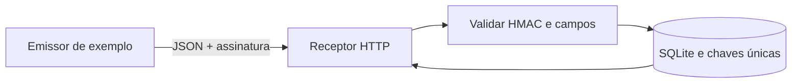

# Ponte ERP

> Laboratório de integração de pedidos via webhook.

**[Abra a demonstração no navegador](https://raphael-kaych.raphaelvindex.chatgpt.site/demos/ponte-erp)** para assinar um evento fictício e testar duplicidade, conflito e assinatura inválida. A versão local abaixo executa o receptor HTTP em Python.

[Estudo de caso e arquitetura](https://raphael-kaych.raphaelvindex.chatgpt.site/projetos/ponte-erp)

Se o emissor perde a resposta de um webhook, ele pode reenviar o mesmo evento. O receptor valida a assinatura HMAC-SHA256 do corpo bruto e grava o pedido no SQLite. As chaves únicas de evento e pedido impedem a duplicação, inclusive com reenvios concorrentes.

| Situação | HTTP |
| --- | --- |
| Primeiro recebimento válido | `201` |
| Mesmo evento, pedido e valor | `200` |
| Evento reutilizado com outro valor ou outro evento para o mesmo pedido | `409` |
| Assinatura ausente ou incorreta | `401` |

## Arquitetura



## Requisitos e execução no PowerShell

Com Python 3.10 ou superior, abra dois terminais na pasta do projeto. No primeiro, inicie o receptor com um valor de teste.

```powershell
$env:PONTE_SEGREDO = 'segredo-local-de-demo'
python ponte.py
```

No segundo, envie o pedido duas vezes e tente alterar o valor com o mesmo identificador.

```powershell
$env:PONTE_SEGREDO = 'segredo-local-de-demo'
python enviar_exemplo.py
python enviar_exemplo.py
python enviar_exemplo.py --total 19000
python -m unittest -v
```

Com um banco novo, a sequência retorna `201`, `200` e `409`. Pare o receptor com `Ctrl+C`. Para repetir a demonstração com outra base, inicie o receptor com `python ponte.py --banco outra-demo.sqlite3`.

## Decisões do laboratório

O contrato usa o tipo `pedido.criado`, identificadores de evento e pedido, e o total em centavos inteiros. A mesma transação verifica a duplicidade e registra o pedido. Um evento reenviado com os mesmos campos relevantes recebe sucesso sem nova gravação.

## Testes e limites

`python -m unittest -v` verifica assinatura incorreta, JSON e campos inválidos, reenvio concorrente e conflitos de ID. A demo no navegador usa uma chave fictícia e reproduz os retornos no cliente.

O receptor local escuta em `127.0.0.1` e registra pedidos em SQLite. Uma integração externa exigiria HTTPS, validade de assinatura e controle de entrega posterior ao ERP.
